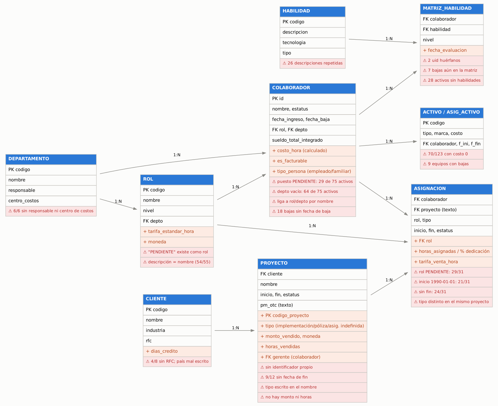

# Etapa 2 · Exploración de datos de OT Consulting

**Rubén David Rodríguez Treviño** (A01198984) · Soporte analítico para la toma de decisiones (TI2006B, Gpo 301)
Socio formador: OT Consulting México · 17 de noviembre de 2026

Aquí documento lo que hice en la etapa 2 del reto: explorar los datos de la app de OT archivo por archivo y columna por columna. El código está en el notebook de esta carpeta y en este documento explico qué encontré.

**¿Qué hay en esta carpeta?**

- `README.md`: esta documentación.
- `Etapa2_Exploracion_OT_RubenRodriguez.ipynb`: el notebook con todo el código y sus resultados.
- `modelo_sugerido.png`: el modelo de datos con los errores marcados.

---

## 1. Objeto de estudio

**¿Cuál es el problema?**

OT Consulting vende proyectos y talento, por lo que gran parte de sus costos están en nóminas. Cuando un consultor se encuentra sin proyecto, sigue cobrando aunque la empresa no esté facturando por su trabajo. Además, en la entrevista nos indicaron que las tarifas han caído de unos 100 USD/hora a entre 40 y 50 USD/hora, mientras que algunos clientes tardan hasta 120 días en pagar. Todo esto hace que tener gente en la banca afecte directamente al dinero disponible.

El director necesita saber quiénes son sus consultores, qué hacen y cuánto gana cada proyecto. Antes llevaban gran parte de la información en Excel y ahora la están pasando a una app interna, pero todavía faltan datos importantes.

**¿Qué estoy analizando?**

Los registros de la app OTC Sandbox - HR Management: colaboradores, sueldos, habilidades, clientes, proyectos y asignaciones.

El hecho principal es la asignación de una persona a un proyecto durante un periodo determinado: quién trabaja, dónde, por cuánto tiempo y a qué costo y tarifa. De ahí se pueden obtener los indicadores de disponibilidad, banca y rentabilidad.

**¿Cuál es mi meta en esta etapa?**

Comprobar si los datos son suficientes para responder tres preguntas del director:

- Cuánto cuesta cada consultor y qué sabe hacer.
- Quién está asignado y quién está disponible.
- Qué margen deja cada proyecto.

Todavía no estoy calculando las respuestas. Esta es la segunda fase de CRISP-DM, entendimiento de los datos. Como la base es de prueba y todos los colaboradores se apellidan Pérez, me interesa principalmente cómo se estructura la información.

## 2. Metadata

La app está desarrollada en HTML y guarda los datos en Firebase (Firestore). Entré con el usuario del equipo y extraje sus 9 colecciones, con corte al 16 de noviembre de 2026. Separé la información que estaba guardada dentro de otros registros, como los proyectos dentro de los clientes, y terminé con 11 archivos CSV.

Por privacidad, no extraje contraseñas, domicilios, datos médicos ni beneficiarios. Los campos de RFC, CURP, NSS, email y teléfono los convertí en indicadores 1/0, que únicamente muestran si el dato existe o está vacío. De los enlaces a documentos solo dejé cuántos tiene cargados cada persona.

En la siguiente matriz distingo llaves, métricas y atributos. PK significa llave primaria y FK llave foránea. Las llaves y los atributos son principalmente texto; los importes están en pesos y las fechas se guardan como texto con formato AAAA-MM-DD.

| Tabla y tamaño | Llaves y relaciones | Métricas | Atributos principales |
|---|---|---|---|
| colaboradores (107 × 30) | id (PK), uid; puesto y depto se ligan por nombre | Sueldo integrado, sueldo neto, componentes, comisión, IMSS, docs_cargados | Nombre, estatus, nómina, ciudad, género, SGMM, seguro de vida, fechas de ingreso y baja |
| roles (55 × 7) | codigo (PK); depto por nombre | Ninguna | Nombre, nivel, estatus |
| departamentos (6 × 7) | codigo (PK) | Ninguna | Nombre, responsable, objetivo, centro de costos, estatus |
| habilidades (71 × 6) | codigo (PK) | Ninguna | Descripción, tecnología, tipo, estatus |
| matriz_habilidades (1,539 × 3) | uid_colaborador y codigo_habilidad (FK) | Ninguna | Nivel de Básico a Experto |
| clientes (8 × 15) | codigo (PK), uid | n_proyectos | Nombre, industria, RFC, ubicación, contacto, estatus |
| proyectos (12 × 10) | uid_cliente (FK) + nombre; sin código propio | Ninguna | Estatus, gerente, contacto, inicio y fin |
| asignaciones (31 × 7) | uid_colaborador; proyecto y rol relacionados por nombre | Ninguna | Tipo, estatus, inicio y fin |
| activos (123 × 13) | codigo (PK) | Costo, n_asig | Tipo, marca, modelo, proveedor, estatus, compra y garantía |
| activos_asignaciones (91 × 5) | codigo_activo y uid_colab (FK) | Ninguna | Notas, fecha de inicio y fin |
| usuarios (6 × 5) | uid | Ninguna | Login, nombre, rol, estatus |

Lo primero que noté es que proyectos y asignaciones no tienen monto, horas ni tarifa. Es decir, la app guarda quién participa, pero no la información necesaria para calcular cuánto gana OT en cada proyecto.

El perfil de todas las columnas está en la sección 3 del notebook.

## 3. Errores, faltantes e inconsistencias

En el modelo sugerido marqué en naranja (+) los nuevos campos y en rojo (⚠) los errores.

Para revisar la calidad hice un perfil de cada tabla. Busqué campos vacíos, duplicados, tipos incorrectos y valores extraños. No encontré IDs duplicados, aunque sí 26 descripciones de habilidades repetidas; por ejemplo, GL aparece en EBS y en Cloud. También comprobé con SQL que las relaciones entre tablas fueran válidas.

Comparé los datos extraídos con la app y los totales coincidieron:

- 107 colaboradores.
- 1,539 registros de habilidades.
- 31 asignaciones.
- $4,494,486.65 de sueldo total integrado.
- $567,915.55 de costo de equipos.

Esto me permitió confirmar que la extracción no perdió registros.

En fechas, hay ingresos desde 2003, pero las asignaciones con fechas reales solo abarcan de noviembre de 2025 a octubre de 2026. Por lo tanto, la app muestra principalmente la situación actual, no un historial completo.

**Principales faltantes**

- **Asignaciones:** 29 de 31 tienen el rol PENDIENTE y 24 no tienen fecha de fin.
- **Colaboradores activos:** de 75, hay 29 con puesto PENDIENTE, 64 sin departamento, 5 con costo en cero y 28 sin habilidades registradas.
- **Proyectos:** de 12, hay 9 sin fecha de fin, 6 sin fecha de inicio y 6 sin gerente de OT.
- **Activos:** 70 de 123 tienen costo en cero y ninguno tiene garantía registrada.

**Errores e inconsistencias**

- 21 asignaciones empiezan el 1990-01-01, una fecha de relleno; en equipos aparece incluso 0199-01-01.
- Dos registros de habilidades apuntan a colaboradores que no existen.
- De las 32 bajas, 18 no tienen fecha de salida y 12 todavía muestran sueldo. Además, 7 siguen en habilidades y 9 equipos continúan asignados a personas dadas de baja.
- Tres asignaciones quedan fuera de las fechas de su proyecto y 18 aparecen "En Curso" aunque el proyecto está "Por Iniciar".
- Hay nombres escritos de distintas formas, como "Méxcio", "Mèxico" y DELL. Esto puede provocar errores al filtrar o agrupar.

Lo más delicado es la estructura: los proyectos no tienen código único, varias tablas se relacionan por nombre, PENDIENTE se acepta como rol y los campos importantes no son obligatorios.

Además, aparecen dos familiares como activos con costo de nómina. Los seis usuarios tienen rol Administrador y la colección guarda contraseñas como un campo más. No las extraje, pero es un tema que considero necesario avisar al socio.

**Mi lectura:** varios errores vienen de que la app permite guardar datos incompletos. Y justo faltan los campos relacionados con el dinero que necesita el director para analizar la rentabilidad.

## 4. Reglas de negocio

**Reglas que explicó OT en la entrevista**

1. **Costo por hora:** (sueldo total integrado × 1.20) / 176 horas mensuales. El 20% adicional corresponde al costo administrativo.
2. **Cotización:** cada semana se convierte en 40 horas y se multiplica por la tarifa del rol.
3. **Margen objetivo:** 20 a 30% sobre el costo. Se agrega 15 a 20% en proyectos complejos y una comisión de 3 a 5% cuando un socio recomienda al cliente.
4. **Dedicación:** un consultor suele estar en un proyecto; un gerente puede atender 3 o 4, dedicando 20 a 30% de su tiempo a cada uno.
5. **Habilidades:** se evalúan cada seis meses como Básico, Intermedio, Avanzado o Experto.
6. **Tipos de proyecto:** implementación, póliza de soporte o asignación indefinida.

**Reglas que propongo para preparar los datos**

1. Calcular plantilla, nómina y banca solo con personal activo. Toda baja debe tener fecha de salida.
2. Exigir puesto, departamento y costo mayor a cero. PENDIENTE no debe contar como un valor real. También separaría administrativos y familiares de los consultores facturables.
3. Relacionar las tablas por códigos únicos y no por nombres.
4. Aceptar una asignación únicamente si tiene rol, fecha de inicio válida, fecha de fin o condición indefinida y fechas dentro del proyecto.
5. Evitar que una persona supere el 100% de dedicación en un mismo periodo.
6. Al registrar una baja, cerrar la asignación de equipos y actualizar la matriz de habilidades.
7. Usar catálogos para país, ciudad, marca, tipo de proyecto y SGMM; unificar espacios y mayúsculas, y convertir fechas a tipo fecha.
8. Tratar 1990-01-01 y 0199-01-01 como datos vacíos, excluir registros de habilidades sin colaborador y marcar los costos en cero como faltantes.

Considero que estas reglas ayudarían a corregir lo que ya existe y, sobre todo, a evitar que se sigan capturando los mismos errores.

## 5. Preguntas detonadoras

Estas son las preguntas que usaría para orientar las siguientes fases. En esta etapa todavía no las estoy respondiendo.

**Consultores**

1. ¿Cuántos consultores facturables tiene OT y cuánto cuesta cada uno por hora, a partir de su sueldo mensual?
2. ¿Qué habilidades importantes dependen de una sola persona?
3. ¿Quién está disponible con una habilidad y nivel específicos?

**Asignaciones**

4. ¿Cuántos consultores están en la banca y cuánto cuestan al mes?
5. ¿Quiénes se liberan en 30, 60 y 90 días?
6. ¿Qué porcentaje de la nómina está asignado a proyectos?
7. ¿Hay personas con más del 100% de dedicación?

**Proyectos y rentabilidad**

8. ¿Qué margen deja cada proyecto y cuáles quedan por debajo del 20%?
9. ¿Qué clientes o tipos de proyecto generan mejores márgenes?
10. ¿Cuáles son los 10 consultores que generan mayor utilidad?
11. ¿Cuánto se espera facturar en los próximos meses?

**Calidad de los datos**

12. ¿Qué tan completos están los registros y quién los mantiene actualizados?

## 6. Métricas existentes y nuevas

Para mí, una métrica es algo que puedo contar o calcular directamente con los datos. Un indicador utiliza esas métricas para evaluar cómo va el negocio.

**¿Qué métricas puedo obtener hoy?**

- 75 colaboradores activos y 32 bajas.
- Personal por puesto, departamento y nómina.
- Sueldo integrado y nómina total.
- Habilidades por persona y nivel.
- Asignaciones por consultor y su duración.
- Proyectos por cliente y estatus.
- Número y costo de equipos.
- Porcentaje de campos llenos.

**¿Qué métricas faltan?**

- Monto y horas vendidas por proyecto.
- Horas o porcentaje de dedicación por persona.
- Tarifa de venta por hora.
- Ingreso por asignación (horas × tarifa).
- Costo por asignación (horas × costo por hora).
- Fecha de la última evaluación de habilidades.

Estas últimas métricas no se pueden calcular porque los campos no existen en la app.

Por eso, además de limpiar la base, OT necesita empezar a capturar esa información para poder analizar correctamente sus proyectos.

## 7. Indicadores

La letra P se refiere a la pregunta correspondiente del punto 5.

| Indicador | Cálculo | ¿Se puede obtener hoy? |
|---|---|---|
| Costo por hora (P1) | Sueldo integrado × 1.20 / 176 | Sí, para 70 de 75 activos; 5 tienen costo cero. |
| Disponibilidad por habilidad (P2, P3) | Personas libres con habilidad y nivel requerido | Parcial: 28 activos sin habilidades. |
| Banca y su costo (P4) | Facturables sin proyecto y costo mensual | Parcial: aparecen 45 sin asignación, pero faltan registros. |
| Liberación en 30, 60 y 90 días (P5) | Asignaciones que terminan en cada periodo | Parcial: 24 de 31 sin fecha de fin. |
| Porcentaje de nómina asignada (P6) | Nómina asignada / nómina total de activos | Parcial: 49%, pero mezcla administrativos y supone 100% de dedicación. |
| Personas sobreasignadas (P7) | Suma de dedicación superior al 100% | No: falta el porcentaje de dedicación. |
| Margen por proyecto (P8, P9) | (Monto vendido - costo de asignaciones) / monto vendido | No: faltan monto, horas y tarifa. |
| Top 10 más rentables (P10) | Ingreso - costo por consultor | No: faltan tarifas y horas. |
| Facturación proyectada (P11) | Ingreso previsto de asignaciones por mes | No: la app no registra facturación. |
| Completitud de datos (P12) | Campos llenos / campos obligatorios | Sí. |

Aquí veo una diferencia importante: OT puede calcular cuánto le cuesta un consultor, pero todavía no cuánto le genera.

Tampoco tomaría las 45 personas sin asignación como una cifra definitiva de banca, porque hay administrativos mezclados y asignaciones que faltan por capturar.

Para mí, primero habría que mejorar los datos de costo, disponibilidad y margen, ya que son los que están más relacionados con las necesidades del director.

## 8. Atributos adicionales

Después de revisar la información, propongo incorporar estos campos para poder responder las preguntas del director:

- **Proyectos:** código único, tipo, monto vendido, moneda, horas vendidas y gerente ligado a colaboradores. Así se podría calcular el margen e identificar correctamente cada proyecto.
- **Asignaciones:** código del rol, horas o porcentaje de dedicación y tarifa por hora. Con eso podría calcular tanto el ingreso como el costo de cada asignación.
- **Roles:** tarifa estándar y moneda, para estimar ingresos cuando no exista una tarifa negociada. Es importante porque las tarifas se manejan en dólares y los costos en pesos.
- **Colaboradores:** si son facturables, si son empleados o familiares y su costo por hora. Esto permitiría calcular la banca sin mezclar personal administrativo.
- **Matriz de habilidades:** fecha de evaluación, porque OT evalúa cada seis meses y hoy no se sabe qué tan vigente está el nivel registrado.
- **Clientes:** días de crédito, ya que algunos pagan hasta 120 días después y eso afecta la proyección del dinero que recibe la empresa.

Considero que estos campos son necesarios para que la información de la app realmente pueda utilizarse en los análisis que necesita OT Consulting.

## 9. Evidencia

Todo el código está en [Etapa2_Exploracion_OT_RubenRodriguez.ipynb](Etapa2_Exploracion_OT_RubenRodriguez.ipynb), en esta misma carpeta. GitHub lo muestra con el código y el resultado de cada celda. Ahí se ve la importación de los 11 archivos (sección 2), el perfil de cada tabla (sección 3), las consultas SQL de integridad (sección 4), el resumen de errores, el modelo sugerido y las pruebas de los indicadores.

También se puede abrir en Google Colab: https://colab.research.google.com/drive/19_I_zNbDkwUPm8CUAebWfNzKl7qf7yK7

**Bitácora de trabajo**

Primero revisé los módulos de la app y extraje las 9 colecciones. Después separé los datos en 11 CSV, protegí los campos personales y comparé sus totales con la app.

Finalmente, utilicé pandas para revisar las tablas y SQL para comprobar las relaciones, y preparé el modelo de datos y los indicadores propuestos.

Los archivos CSV no están en el repositorio porque vienen de la app interna de OT.

## Conclusión

Después de revisar la base, creo que la app sí permite conocer al personal de OT Consulting, sus costos y parte de sus habilidades.

El problema es que todavía no puede mostrar cuánto deja cada proyecto, porque no registra montos, horas ni tarifas. También encontré errores que la propia app permite guardar, como fechas de relleno y asignaciones incompletas.

Por eso, antes de construir el tablero que quiere el director, considero necesario aplicar las reglas de limpieza y agregar los campos que faltan.

Esto permitiría trabajar con información más confiable y sería lo siguiente que tendría que hacer en la fase de preparación de datos.
