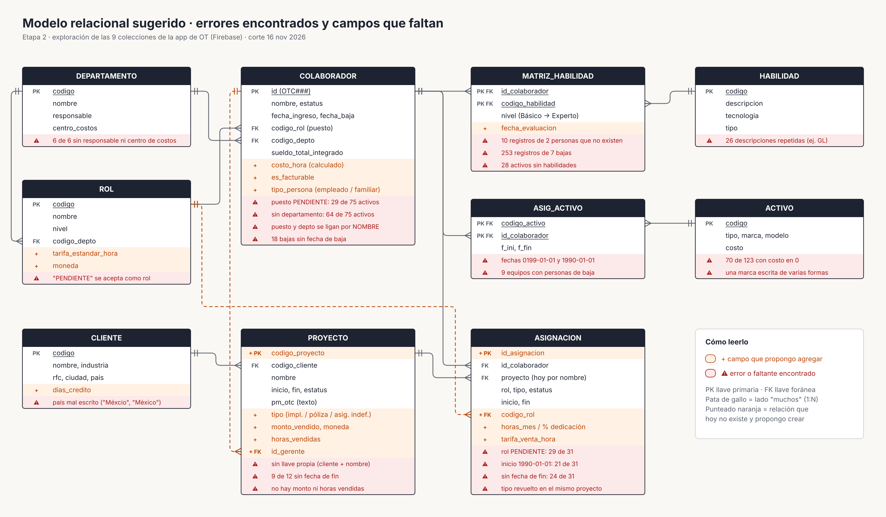
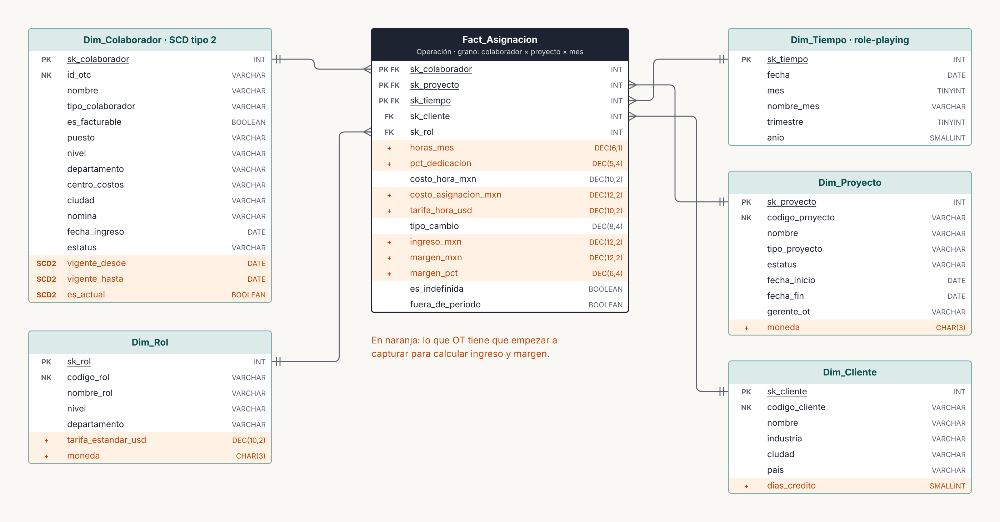

# Etapa 4: Modelo dimensional de OT Consulting

**Equipo 1**, Soporte analítico para la toma de decisiones (TI2006B, Gpo 301)

Socio formador: OT Consulting México, noviembre 2026

- Rubén David Rodríguez Treviño (A01198984)
- Erika Esquivel Correa (A00841206)
- Iván Fundora Velasco (A01198822)
- Julen Benages Díaz (A01832758)

Con los datos ya limpios de la etapa 3, en esta etapa diseñamos cómo se tienen que guardar para poder analizarlos. Usamos Kimball: tablas de hechos con los números del negocio y dimensiones con el contexto para filtrar (quién, en qué proyecto, cuándo).

**¿Qué hay en esta carpeta?**

- `OT_Modelos.drawio`: los tres diagramas, se pueden abrir y editar en app.diagrams.net.
- `modelo_relacional_sugerido.png`: el modelo que proponemos para la app de OT.
- `modelo_dimensional_logico.png`: el modelo dimensional completo.
- `estrella_fact_asignacion.png`: el zoom a la estrella de asignaciones.

## 1. Primero hay que arreglar la app

De nada sirve el modelo dimensional si la app sigue guardando datos incompletos. Por eso el primer diagrama es relacional. Ahí están las tablas de la app con sus errores en rojo (proyectos sin llave propia, asignaciones sin horas ni tarifa, tablas que se ligan por nombre) y en naranja los campos que OT tendría que empezar a capturar.

## 2. El modelo dimensional

Nos quedó una constelación: cuatro tablas de hechos que comparten las dimensiones Colaborador y Tiempo. No hicimos una sola estrella porque en OT hay varios procesos y cada uno tiene un nivel de detalle distinto. Así se pueden cruzar sin mezclar granos.

| Hecho | Grano (un renglón es) | Data mart |
|---|---|---|
| Fact_Asignacion | un colaborador en un proyecto en un mes | Operación |
| Fact_CostoColaborador | un colaborador en un mes | People |
| Fact_Habilidad | un colaborador con una habilidad en una evaluación | People |
| Fact_Proyecto | un proyecto vendido (fase 2, con el CRM) | CRM_Clientes |

Matriz bus, para ver qué dimensiones usa cada hecho:

| | Colaborador | Tiempo | Proyecto | Cliente | Rol | Habilidad |
|---|:-:|:-:|:-:|:-:|:-:|:-:|
| Fact_Asignacion | X | X | X | X | X | |
| Fact_CostoColaborador | X | X | | | | |
| Fact_Habilidad | X | X | | | | X |
| Fact_Proyecto | | X | X | X | | |

## 3. Decisiones que tomamos

- Llaves sustitutas (`sk_`): cada dimensión tiene su propio número interno y guarda el ID de la app como llave natural. Así no dependemos de cómo numera la app.
- SCD tipo 2 en Dim_Colaborador: si alguien cambia de puesto o de sueldo no se borra lo anterior, se agrega otro renglón con `vigente_desde`, `vigente_hasta` y `es_actual`. Un reporte de marzo usa el puesto que tenía en marzo.
- Dimensiones degeneradas: `estado_banca` y `id_oportunidad_crm` se quedan dentro del hecho, no necesitan tabla propia.
- Tiempo role-playing: es una sola Dim_Tiempo que se usa como mes del corte, fecha de evaluación y fecha de cierre.
- Sin copo de nieve: puesto y departamento van dentro de Dim_Colaborador. Son menos joins y es más fácil en Tableau.
- Margen sobre el costo: `margen_pct` = (ingreso − costo) / costo, porque así lo mide OT (meta de 20 a 30%).

## 4. La estrella de asignaciones

Fact_Asignacion es la que contesta la pregunta principal del reto: quién está en qué proyecto, cuánto cuesta y cuánto deja. Lo que está en naranja (horas, % de dedicación, tarifa, ingreso y margen) hoy no existe en la app. Mientras OT no lo capture, el margen solo se puede sacar como escenario, como lo hicimos en la etapa 3.

## 5. Cómo se mueven los datos

App de OT y Excel, luego la limpieza en Python (el notebook de la etapa 3), luego el almacén con los data marts People, Operación y CRM_Clientes, y al final el tablero en Tableau. El CRM entra en una fase 2 porque en la etapa 1 quedó fuera del alcance del reto.
