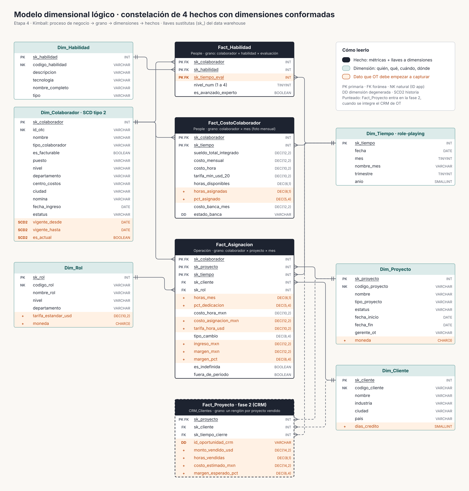

# Etapa 4 · Modelo dimensional de OT Consulting

**Equipo 1** · Soporte analítico para la toma de decisiones (TI2006B, Gpo 301) · Socio formador: OT Consulting México · noviembre 2026

- Rubén David Rodríguez Treviño · A01198984
- Erika Esquivel Correa · A00841206
- Iván Fundora Velasco · A01198822
- Julen Benages Díaz · A01832758

Con los datos ya limpios de la etapa 3, aquí diseñamos cómo se van a guardar para analizarlos. Usamos la metodología de Kimball: tablas de hechos con los números del negocio y dimensiones con el contexto para filtrar (quién, qué proyecto, cuándo).

**¿Qué hay en esta carpeta?**

- `OT_Modelos.drawio`: los tres diagramas editables. Se abre en [app.diagrams.net](https://app.diagrams.net).
- `modelo_relacional_sugerido.png`: el modelo que proponemos para la app de OT.
- `modelo_dimensional_logico.png`: el modelo dimensional completo.
- `estrella_fact_asignacion.png`: el zoom a la estrella principal.

## 1. Primero, arreglar la app

El modelo dimensional sirve de poco si la app sigue guardando datos incompletos. Por eso el primer diagrama es relacional: muestra las tablas de la app con sus errores en rojo (proyectos sin llave propia, asignaciones sin horas ni tarifa, tablas que se ligan por nombre) y en naranja los campos que OT tiene que empezar a capturar.

## 2. El modelo dimensional

Es una constelación: cuatro tablas de hechos que comparten las dimensiones Colaborador y Tiempo. Elegimos constelación y no una sola estrella porque OT tiene varios procesos con distinto nivel de detalle, y así se pueden cruzar sin mezclar granos.

| Hecho | Grano (un renglón es…) | Data mart |
|---|---|---|
| Fact_Asignacion | un colaborador en un proyecto en un mes | Operación |
| Fact_CostoColaborador | un colaborador en un mes (foto mensual) | People |
| Fact_Habilidad | un colaborador, una habilidad, una evaluación | People |
| Fact_Proyecto | un proyecto vendido (fase 2, cuando se conecte el CRM) | CRM_Clientes |

**Matriz bus** (qué dimensiones usa cada hecho):

| | Colaborador | Tiempo | Proyecto | Cliente | Rol | Habilidad |
|---|:-:|:-:|:-:|:-:|:-:|:-:|
| Fact_Asignacion | ✓ | ✓ | ✓ | ✓ | ✓ | |
| Fact_CostoColaborador | ✓ | ✓ | | | | |
| Fact_Habilidad | ✓ | ✓ | | | | ✓ |
| Fact_Proyecto | | ✓ | ✓ | ✓ | | |

## 3. Decisiones de diseño

- **Llaves sustitutas (`sk_`).** Cada dimensión tiene su propio número interno y guarda el ID de la app como llave natural (NK). Así el almacén no depende de cómo la app numere las cosas.
- **SCD tipo 2 en Dim_Colaborador.** Si alguien cambia de puesto o de sueldo, no se sobrescribe: se agrega otro renglón con `vigente_desde`, `vigente_hasta` y `es_actual`. Un reporte de marzo usa el puesto que tenía en marzo.
- **Dimensiones degeneradas.** `estado_banca` en Fact_CostoColaborador e `id_oportunidad_crm` en Fact_Proyecto viven en el hecho, sin tabla propia.
- **Tiempo role-playing.** Una sola Dim_Tiempo que hace de mes del corte, fecha de evaluación y fecha de cierre.
- **Sin copo de nieve.** Puesto y departamento van dentro de Dim_Colaborador. Son menos joins y es más fácil de usar en Tableau.
- **Margen sobre costo.** `margen_pct` = (ingreso − costo) ÷ costo, porque así lo mide OT (meta de 20 a 30%).

## 4. La estrella principal

Fact_Asignacion responde la pregunta central del reto: quién está en qué proyecto, cuánto cuesta y cuánto deja. Los campos en naranja (horas, % de dedicación, tarifa, ingreso y margen) hoy no existen en la app. Mientras OT no los capture, el margen solo se puede calcular como escenario, como hicimos en la etapa 3.

## 5. Cómo fluyen los datos

App de OT y Excel → limpieza en Python (el notebook de la etapa 3) → almacén con los data marts People, Operación y CRM_Clientes → tablero en Tableau. El CRM se conecta en la fase 2, porque en la etapa 1 quedó fuera del alcance del reto.
