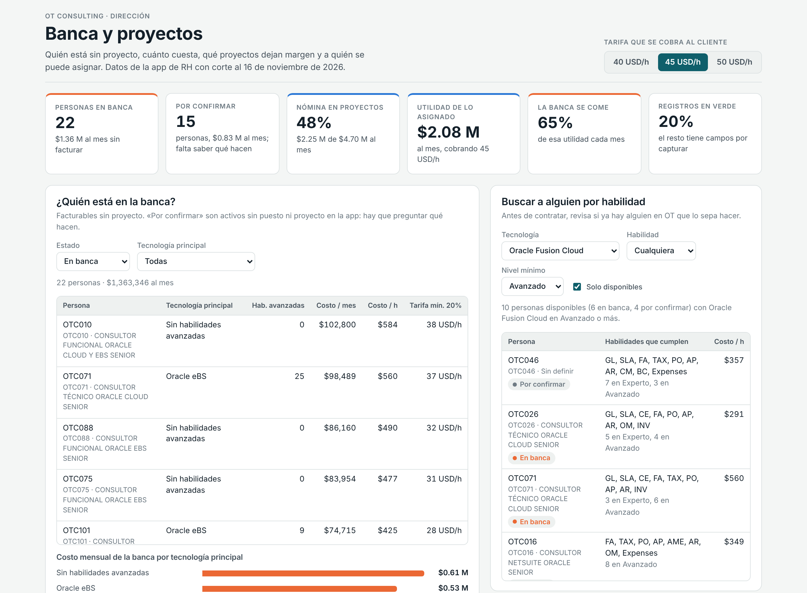

# AVANCE RETO ETAPA 5
## Construcción del Modelo Dimensional Físico y Mecanismos de Análisis (1a. parte)

**Integrantes**
- Erika Esquivel Correa – A00841206
- Iván Fundora Velasco – A01198822
- Julen Benages Díaz – A01832758
- Rubén Rodríguez – A01198984
- Javier Barrón Vargas – A00842507

**Fecha:** 24 de noviembre de 2026
**Profesora:** Maria Imelda Valdez
**Materia:** Soporte analítico para la toma de decisiones
**Grupo:** 301

**Ligas del proyecto**
- Tablero para la Dirección: https://claude.ai/artifact/UA3ARbDjUQMV9ZpvCYykvc
- Notebook, modelo físico y scripts: https://github.com/rubendrt42-eng/SQL-Analitica-Ruben/tree/main/Etapa5_OT

## 1. ¿Qué se hizo en esta etapa?

En la etapa 4 definimos un modelo estrella con una tabla de hechos (fact_asignacion) y seis dimensiones. En esta etapa nuestro objetivo fue llevar ese diseño a la práctica y crear un modelo físico con el que pudiéramos trabajar los datos de OT.

Iniciamos creando las tablas en SQL, con sus llaves y las restricciones para garantizar la integridad de los datos. Luego utilizamos los datos que habíamos limpiado en la etapa 3 para llenar las tablas, verificar los valores de cada dimensión y redactar las consultas que responden las 12 preguntas de negocio que nos planteamos desde la etapa 2.

Con esos resultados creamos un tablero para la Dirección de OT que puede ser integrado a la infraestructura actual de la empresa.

Todo el proceso se encuentra en un notebook que se puede ejecutar en Google Colab y en un script que actualiza únicamente los datos del tablero.

## 2. ¿Cómo quedó el modelo físico?

Para crear el modelo físico usamos las siete tablas de la etapa anterior. Al crearlo nos percatamos de que requeríamos dos tablas más para mostrar bien las habilidades de los colaboradores: un colaborador puede tener varias habilidades y una habilidad la pueden tener varios colaboradores. Por eso usamos una tabla puente, como sugiere la metodología de Kimball.

| Tabla | Registros | Qué almacena |
|---|---|---|
| fact_asignacion | 76 | Los colaboradores activos y sus asignaciones |
| dim_colaborador | 75 | La información, el costo y el estado de cada colaborador |
| dim_proyecto | 13 | Los 12 proyectos y la categoría «Sin asignación» |
| dim_cliente | 9 | Los 8 clientes y la categoría «Sin cliente» |
| dim_fecha | 1,462 | Calendario de 2025 a 2028, más «Sin fecha» |
| dim_detalle_asignacion | 16 | El rol y la situación de cada asignación |
| dim_calidad | 18 | El semáforo de calidad y los campos pendientes |
| dim_habilidad | 71 | El catálogo de habilidades |
| puente_colaborador_habilidad | 1,276 | Qué habilidades tiene cada colaborador y en qué nivel |

En el modelo físico establecimos el tipo de dato de cada columna, las llaves primarias, las llaves foráneas y algunas restricciones con reglas CHECK. Por ejemplo, el semáforo de calidad solo acepta Verde, Amarillo o Rojo, y el nivel de una habilidad debe estar entre 1 y 4.

Usamos SQLite porque corre directo en Google Colab sin instalar otras herramientas. Además, el código SQL se puede llevar a otras plataformas, como BigQuery o PostgreSQL, haciendo pequeños cambios.

Para comprobar que el modelo funcionaba realizamos dos pruebas. La primera consistió en verificar que todas las llaves foráneas apuntaran a un registro que sí existe. En la segunda volvimos a unir las tablas con SQL para ver si podíamos reconstruir la tabla original. Recuperamos los 76 registros y las 51 columnas sin ninguna diferencia.

## 3. ¿Qué valores tiene cada dimensión?

Con el modelo ya creado verificamos qué información tiene cada dimensión. En las columnas con diez valores distintos o menos, los listamos; en las que tienen más, describimos su contenido. Los nombres de los colaboradores y los esquemas de nómina no los mostramos, solo decimos cuántos hay, porque en un entorno real es información delicada.

### 3.1. Dimensión colaborador (dim_colaborador)

Tiene 75 registros, uno por cada colaborador activo de OT.

| Campo | Valores distintos | Valores |
|---|---|---|
| tipo_colaborador | 6 | Consultor, Consultor (inferido), Gerente de proyectos, Administrativo, Familiar y Sin definir |
| es_facturable | 2 | Sí (52) y No (23) |
| estado_banca | 4 | Asignado (30), En banca (22), Por confirmar (15) y No facturable (8) |
| nivel | 4 | Senior, Gerente, Analista y Practicante; 29 colaboradores no tienen nivel |
| departamento | 4 | Operaciones y Soporte, Administración y Finanzas, Ventas y Recursos Humanos; 31 no tienen departamento |
| depto_origen | 3 | Capturado, catálogo de roles y sin dato |
| tecnologia_principal | 4 | Plataformas Tecnológicas, Oracle eBS, Oracle Fusion Cloud e Idiomas |
| baja_programada | 2 | Sí (1) y No (74) |
| costo_faltante | 2 | Sí (5) y No (70) |
| captura_masiva | 2 | Sí (2) y No (73) |

Las columnas con más de diez valores son estas:
- **ID y nombre:** 75 cada uno, uno por persona, del OTC003 al OTC107.
- **Puesto:** 23 puestos distintos, sobre todo de consultoría funcional y técnica de Oracle. 29 colaboradores quedaron como «Sin definir» porque su puesto decía PENDIENTE.
- **Ciudad:** 18 ciudades. La mayoría está en Monterrey (42 colaboradores), luego el Estado de México (8) y la Ciudad de México (5).
- **Nómina:** 8 esquemas distintos, que no listamos por ser información delicada.
- **Antigüedad:** 51 valores distintos, de 0.1 a 23.6 años.
- **Sueldo total integrado:** 66 valores, de $7,450 a $135,461 al mes.
- **Costo mensual:** de $8,940 a $162,553.
- **Costo por hora:** de $50.80 a $923.60.
- **Tarifa mínima para un margen de 20%:** de 3.3 a 59.7 USD por hora. Para 30%: de 3.6 a 64.7 USD por hora.
- **Habilidades:** cada colaborador tiene entre 0 y 68 habilidades registradas. En nivel Avanzado o Experto, entre 0 y 39.

Algo que nos llamó la atención es que 33 colaboradores no tienen ninguna habilidad registrada en nivel Avanzado o Experto. Eso le quita opciones a la empresa cuando busca perfiles para un proyecto nuevo.

### 3.2. Dimensión proyecto (dim_proyecto)

Tiene 13 registros: 12 proyectos y la categoría «Sin asignación». Como son más de diez, los describimos: los proyectos van del código P001 al P012, y el P000 es para los colaboradores sin asignación.

Hoy solo cuatro proyectos tienen colaboradores asignados:
- Soporte AMS Manufacta (METALSA)
- Asignación indefinida (METALSA)
- Marazzi (Grupo Daltile)
- Migración eBs (Allegion)

El tipo de proyecto tiene 4 valores distintos:

| Tipo de proyecto | Cantidad |
|---|---|
| Póliza de soporte | 5 |
| Asignación de recursos | 4 |
| Implementación | 3 |
| No aplica | 1 |
| Total | 13 |

### 3.3. Dimensión cliente (dim_cliente)

Tiene 9 registros: los ocho clientes de OT y la categoría «Sin cliente».
- METALSA
- Grupo Daltile
- Allegion
- CITI
- Parker Servicios de México
- Rent A Center (RAC México Operaciones)
- Fanosa
- Novocast

Los códigos van del C0001 al C0008, y el C0000 es «Sin cliente».

### 3.4. Dimensión fecha (dim_fecha)

Armamos un calendario del 1 de enero de 2025 al 31 de diciembre de 2028. Son 1,461 días, más un registro con el valor -1 para los casos en los que no hay fecha.

| Concepto | Resultado |
|---|---|
| Fecha de corte de la información | 16 de noviembre de 2026 |
| Fecha de inicio más antigua | 3 de noviembre de 2025 |
| Fecha de inicio más reciente | 13 de octubre de 2026 |
| Fecha de fin más cercana | 1 de enero de 2027 |
| Fecha de fin más lejana | 1 de julio de 2028 |
| Asignaciones sin fecha de inicio | 21 |
| Asignaciones sin fecha de fin | 24 |

La dimensión también tiene año (4 valores: 2025 a 2028), trimestre (4), mes y nombre del mes (12), día (31) y día de la semana (7). Con eso se pueden hacer análisis por distintos periodos.

### 3.5. Dimensión detalle de asignación (dim_detalle_asignacion)

Tiene 16 registros, que son las combinaciones distintas de rol y situación de las asignaciones, incluida la categoría «No aplica».

| Campo | Valores distintos | Valores |
|---|---|---|
| rol_en_proyecto | 11 | Diez roles y «No aplica». Casi todos son consultores Oracle; también hay perfiles de Kronos, Java y Web, y un gerente de proyectos y operaciones |
| rol_origen | 4 | Capturado, puesto del colaborador, sin dato y No aplica |
| es_indefinida | 2 | Sí (1) y No (0) |
| asignacion_vigente | 1 | Todas las asignaciones están vigentes a la fecha de corte |
| ventana_liberacion | 5 | De 31 a 60 días, más de 90 días, indefinida, sin fecha de fin y No aplica |
| fuera_de_periodo | 2 | Sí, si las fechas de la asignación se salen del periodo del proyecto, y No |

Esta información nos ayuda a conocer la situación de cada colaborador en sus proyectos y a saber cuándo podría estar disponible para otra asignación.

### 3.6. Dimensión calidad (dim_calidad)

Tiene 18 registros y sirve para saber qué tan completa está la información de cada colaborador y sus asignaciones. Revisamos seis campos clave: costo, puesto, habilidades, fecha de inicio, fecha de fin y rol.

El semáforo tiene 3 valores:
- **Verde:** el registro tiene al menos el 80% de sus campos clave.
- **Amarillo:** tiene entre el 50% y el 79%.
- **Rojo:** le falta más de la mitad.

Los campos pendientes forman 17 combinaciones distintas, más una categoría para los registros a los que no les falta nada.

### 3.7. Dimensión habilidad (dim_habilidad)

Tiene las 71 habilidades del catálogo de OT. La tecnología tiene 6 valores distintos:

| Tecnología | Habilidades |
|---|---|
| Oracle eBS | 30 |
| Plataformas Tecnológicas | 20 |
| Oracle Fusion Cloud | 17 |
| Otros | 2 |
| Idiomas | 1 |
| Certificaciones | 1 |
| Total | 71 |

El tipo tiene 2 valores: 67 habilidades técnicas (HARD) y 4 blandas (SOFT).

Hay 71 códigos de habilidad pero solo 58 descripciones distintas, porque módulos como GL, AP, AR, PO y FA aparecen tanto en Oracle eBS como en Oracle Fusion Cloud. El catálogo también incluye plataformas como OCI y OBI, y habilidades blandas.

## 4. ¿Cómo se preparan los datos desde Firebase?

En esta etapa pensamos en cómo podría usar OT nuestra solución después del reto. Por eso buscamos que el proceso se actualizara directo desde la fuente de la empresa y no dependiera solo de los CSV que sacamos al principio.

La app de OT guarda su información en Firestore, en nueve colecciones: colaboradores, usuarios, habilidades, roles, departamentos, matriz_habilidades, clientes, asignaciones y activos. Con esa estructura diseñamos un proceso de cuatro pasos.

**Paso 1. Extraer la información**
Hicimos un script, extraer_firebase.py, que consulta las nueve colecciones con una cuenta de servicio de solo lectura. La información guardada dentro de otros registros la separamos en su propia tabla: los proyectos de cada cliente, las asignaciones de cada colaborador, la matriz de habilidades y el historial de los equipos. Así salen los mismos 11 archivos CSV con los que trabajamos desde la etapa 2.

También cuidamos la privacidad de los colaboradores. El RFC, la CURP, el NSS, el correo y el teléfono se cambian por 1 o 0, según estén registrados o no. Los domicilios, los datos médicos, los beneficiarios y las contraseñas no se extraen, porque no los necesitamos para contestar nuestras preguntas.

**Paso 2. Limpiar los datos**
Usamos el mismo notebook de la etapa 3: corrige las fechas de relleno, quita espacios de más, saca las habilidades de personas dadas de baja, les asigna código a los proyectos e identifica a los colaboradores facturables. También calcula el costo por hora, los escenarios de tarifa y el semáforo de calidad.

**Paso 3. Construir el modelo**
Con los datos limpios armamos las nueve tablas del modelo físico, las cargamos en SQL y revisamos que no hubiera errores en las llaves foráneas.

**Paso 4. Publicar la información**
Al final se genera el archivo datos_tablero.json, que es lo que lee el tablero para mostrar los indicadores.

Para no hacer esto a mano, hicimos otro script, actualizar_tablero.py, que corre los cuatro pasos seguidos y reutiliza el código de nuestros notebooks. Lo probamos con los CSV del 16 de noviembre y dio exactamente los mismos resultados que el notebook.

Una limitación es que no pudimos probar la conexión directa con Firebase, porque se necesita una clave de acceso al proyecto de OT. Por eso agregamos dos medidas:
- La opción --listar, que muestra las colecciones y sus campos antes de extraer nada.
- Un test que frena el proceso en caso de que los ficheros no contengan las columnas que requiere el proceso de limpieza.

## 5. ¿Qué responden las consultas?

Desde la fase 2 establecemos 12 preguntas de negocio relevantes para la toma de decisiones en OT. En esta fase escribimos las consultas en SQL para responderlas con nuestro modelo físico.

La aplicación de OT no registra las tarifas de venta, las horas trabajadas ni los montos vendidos. Por ello, en los análisis de dinero utilizamos tres escenarios de tarifa: 40, 45 y 50 USD por hora. Cuando es suficiente un solo resultado, usamos 45 USD por hora como referencia.

**Pregunta 1. ¿Cuántos consultores facturables hay y cuánto cuestan por hora?**
OT cuenta con 52 colaboradores facturables: 36 están registrados como consultores, 14 los consideramos como consultores ya que están asignados a un proyecto y 2 son gerentes. Un consultor cuesta en promedio $362 MXN por hora, pero existen costos desde $51 hasta $723. Esto nos sirve de referencia para cotizar y evaluar nuevas asignaciones.

**Pregunta 2. ¿Qué habilidades dependen de una sola persona?**
Encontramos cinco habilidades en el nivel Avanzado o Experto que posee solo una persona. Se trata de cuatro colaboradores, tres de los cuales están en banca. Además, hay seis habilidades del catálogo que nadie posee en esos niveles. Lo consideramos como una oportunidad: aprovechar el conocimiento de los que están disponibles y detectar qué formación hace falta.

**Pregunta 3. ¿Quién está disponible con una habilidad y nivel determinados?**
Por ejemplo buscamos colaboradores con Oracle Fusion Cloud en el nivel Avanzado o superior. Encontramos diez personas que podrían asumir una nueva asignación:
- Seis en banca.
- Cuatro con disponibilidad por confirmar.

Esta búsqueda también aparece en el tablero, donde se puede seleccionar la tecnología y el nivel que se requiere.

**Pregunta 4. ¿Cuántos están en banca y cuánto cuestan?**
Actualmente hay 22 consultores en banca, que le cuestan a OT $1,363,346 MXN al mes. Además, hay 15 colaboradores por confirmar. Si ellos tampoco están en un proyecto, el costo aumentaría a unos $2.19 millones al mes. Para nosotros es uno de los resultados más importantes, ya que nos muestra cuánto le cuesta a la empresa la gente que no está trabajando en proyectos.

**Pregunta 5. ¿Quiénes se liberan en 30, 60 y 90 días?**
Desde la fecha de corte, nadie se libera en los próximos 30 días. Tres colaboradores finalizan su asignación el 1 de enero de 2027 y otros cuatro en más de 90 días. Hay 24 asignaciones sin fecha de fin: 18 son indefinidas y en 6 nadie lo registró. De esta forma OT puede anticipar quién va a quedar disponible y planear las siguientes asignaciones.

**Pregunta 6. ¿Qué porcentaje de la nómina está en proyectos?**
El 47.8% de la nómina mensual está asignada a proyectos: unos $2.25 millones de un total de $4.70 millones al mes. Este indicador nos muestra qué parte del coste de la gente está ligado directamente a proyectos y qué parte pertenece a otras funciones.

**Pregunta 7. ¿Hay personas con más del 100% de dedicación?**
No. El único colaborador que está en dos proyectos es un gerente, al que le calculamos un 25% de dedicación en cada uno. Hay que aclarar que estos porcentajes son estimados, ya que la aplicación no registra la dedicación real de cada persona.

**Pregunta 8. ¿Qué margen deja cada proyecto y cuáles quedan por debajo del 20%?**
Ningún proyecto con colaboradores asignados queda por debajo del 20%, ni siquiera cobrando 40 USD por hora. El margen más bajo es el de «Asignación indefinida» de METALSA: 51% cobrando 40 USD por hora. Ese proyecto cuenta con 18 colaboradores y cuesta unos $1.49 millones al mes. Además, 8 de los 12 proyectos no tienen a nadie asignado. Para conocer la rentabilidad real se necesitan las tarifas reales.

**Pregunta 9. ¿Qué clientes o tipos de proyecto dejan mejores márgenes?**
En porcentaje, Allegion tiene el margen más alto, con un 271%, y por tipo de proyecto las implementaciones alcanzan un 184%. En dinero, METALSA es el cliente que más beneficio estimado deja: unos $1.39 millones al mes. Esto nos demostró que el cliente con el mayor porcentaje no siempre es el que más dinero deja.

**Pregunta 10. ¿Quiénes son los diez consultores que dejan más beneficio?**
Los primeros cuatro puestos son de colaboradores asignados a Migración eBs. Hay que tener en cuenta que en el escenario utilizamos la misma tarifa para todos, así que el orden realmente sigue el costo por hora de cada colaborador. Para un ranking más exacto habría que conocer la tarifa que se cobra por cada perfil.

**Pregunta 11. ¿Cuánto se espera facturar en los próximos meses?**
Cobrando 45 USD por hora, en diciembre se facturarían unos $4.33 millones. Según la tarifa, estaría entre $3.85 y $4.82 millones. En enero bajaría a unos $4 millones al mes, ya que se terminan tres asignaciones. Esto nos ayuda a prever que la facturación va a bajar y que hay que buscar nuevas asignaciones.

**Pregunta 12. ¿Los registros están completos y quién los actualiza?**
Así quedó la calidad de los datos:

| Semáforo | Porcentaje de registros |
|---|---|
| Verde | 20% |
| Amarillo | 67% |
| Rojo | 13% |

Los campos que más faltan son:
- Rol del colaborador: 29 registros.
- Puesto: 29 registros.
- Habilidades: 28 registros.

No pudimos saber quién actualiza los datos, ya que la aplicación no registra qué usuario creó o cambió cada registro. Además, en el entorno de pruebas los seis usuarios tienen rol de Administrador. Es algo que OT podría mejorar para controlar mejor la calidad de su información.

## 6. ¿Cómo es la solución para Dirección y cómo se instala?

Armamos un tablero que recoge en un solo lugar todos los resultados de las consultas. La idea es que la Dirección de OT pueda ver la información importante sin necesidad de correr consultas en SQL ni de buscar en distintos archivos.

*Figura 1. Tablero para la Dirección de OT.*

El tablero muestra:
- Cuántos colaboradores hay en banca, quiénes son y cuánto cuestan.
- El margen estimado de cada proyecto en comparación con la meta de 20% a 30%.
- Los colaboradores que se liberan pronto.
- Un buscador de colaboradores por habilidad y nivel.
- Las habilidades que solo tiene una persona.
- Los indicadores de calidad de los datos.

También tiene un selector para cambiar entre los tres escenarios de tarifa (40, 45 y 50 USD por hora). Al cambiarlo, todos los indicadores de dinero se recalculan automáticamente.

**¿Por qué una página web?**
Queríamos una solución que funcionara con las herramientas que OT ya utiliza. Su aplicación está hecha en HTML y vive en Firebase Hosting, así que hicimos el tablero como página web en lugar de usar Tableau. Así se integra a la infraestructura de la empresa sin comprar licencias ni servidores nuevos. Si OT prefiere Tableau, las nueve tablas del modelo también se pueden descargar en CSV.

**Cómo instalar el tablero**
1. Crear una cuenta de servicio en Google Cloud con el rol Cloud Datastore Viewer, que permite consultar los datos sin modificarlos, y descargar su clave de acceso.
2. Instalar lo necesario: `pip install -r requirements.txt`
3. Revisar cómo están organizadas las colecciones de Firebase: `python extraer_firebase.py --credenciales clave.json --listar`
4. Generar los datos del tablero: `python actualizar_tablero.py --credenciales clave.json`
5. Publicar el tablero en Firebase Hosting: `firebase deploy --only hosting:tablero`
6. Programar la actualización automática cada lunes con Cloud Scheduler o con el ejemplo de GitHub Actions que dejamos en el repositorio.

Hay que tener cuidado con la seguridad: todo lo que se publica en Firebase Hosting es público. Con datos de prueba no es problema, pero con los datos reales de los colaboradores recomendamos guardar la información en Firestore, con reglas de seguridad que solo dejen verla a los administradores autorizados.

## 7. Recomendaciones técnicas para OT

A lo largo del reto encontramos cosas que OT podría mejorar en cómo guarda y maneja sus datos. Con estos cambios la empresa aprovecharía mejor la información que ya tiene y los análisis serían cada vez más exactos.

**7.1. Guardar los datos financieros de los proyectos**
Lo que más faltó fueron las horas trabajadas, el porcentaje de dedicación, las tarifas de venta y los montos vendidos. Recomendamos añadir esos campos a la aplicación o, si ya se registran en el CRM, conectarlo. Así se podría dejar de trabajar con escenarios y calcular los indicadores con datos reales.

**7.2. Usar un código único para cada proyecto**
Recomendamos que cada proyecto tenga su propio código y que las asignaciones se liguen con ese código y no con el nombre del proyecto. Así se evitan confusiones y es más fácil relacionar distintas fuentes de información.

**7.3. Hacer obligatorios los campos importantes**
Encontramos muchos registros incompletos, sobre todo en puesto, rol y fechas. Recomendamos que esos campos sean obligatorios y que la aplicación no deje guardar fechas de relleno como el 1 de enero de 1990. Así se evitarían muchos de los problemas que encontramos al limpiar los datos.

**7.4. Controlar mejor a los usuarios y los cambios**
Recomendamos añadir campos que digan quién hizo cada cambio y cuándo, y dar permisos según las tareas de cada usuario en lugar de que todos sean Administrador. Así se sabría quién es responsable de mantener actualizada cada parte de la información.

**7.5. Completar las habilidades de los colaboradores**
Tres de los cuatro colaboradores en banca que más cuestan no tienen ninguna habilidad avanzada registrada. Aunque quizá tienen el conocimiento para nuevos proyectos, hoy no aparecen en las búsquedas del tablero. Recomendamos revisar y actualizar la matriz de habilidades, sobre todo de quienes están libres para nuevas asignaciones.

## 8. Conclusión

En esta fase llevamos a la práctica el modelo dimensional que diseñamos anteriormente. Comprobamos que las tablas se relacionan bien, que se pueden reconstruir los datos originales sin perder información y que el modelo tiene reglas para que los datos entren bien.

También respondimos las 12 preguntas de negocio que planteamos al inicio del reto, lo que nos ayudó a entender mejor qué está pasando en OT y a encontrar cosas que la empresa puede mejorar. No todas las respuestas tienen la misma exactitud: las de banca, habilidades, disponibilidad y calidad de los datos salen de datos reales, mientras que las de dinero todavía dependen de escenarios, ya que faltan las tarifas y las horas trabajadas.

El resultado que más nos llamó la atención fue que los 22 consultores en banca cuestan unos $1.36 millones al mes. Cobrando 45 USD por hora, ese costo equivale a cerca del 65% de la utilidad estimada que dejan los colaboradores asignados. Esto nos muestra que OT puede aprovechar mejor a la gente que ya tiene: antes de contratar a alguien para un proyecto, conviene revisar si en su propia banca hay alguien que lo pueda hacer.

Por último, el tablero es la forma de llevar todo el trabajo de las fases del reto a una herramienta que la empresa pueda usar de verdad. Más que enseñar datos, buscamos que ayude a la Dirección de OT a ver problemas, encontrar oportunidades y tomar decisiones sabiendo mejor lo que pasa en su empresa.
