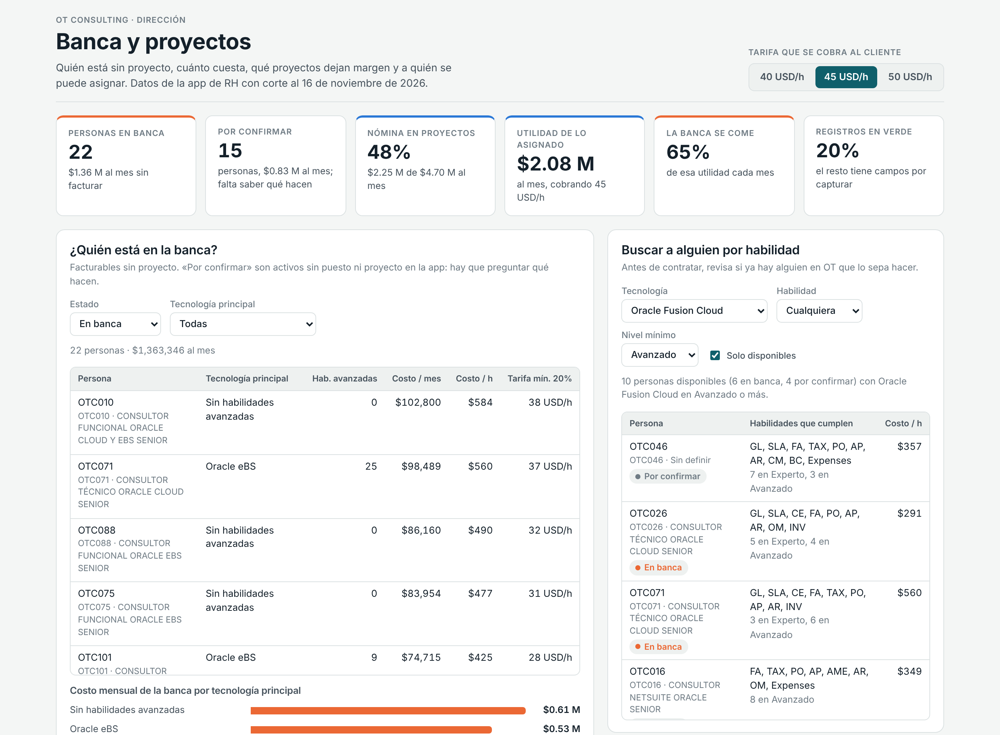

# Etapa 5: Modelo dimensional físico y mecanismos de análisis (1a parte)

**Equipo 1**, Soporte analítico para la toma de decisiones (TI2006B, Gpo 301)

Socio formador: OT Consulting México, noviembre 2026

- Rubén David Rodríguez Treviño (A01198984)
- Erika Esquivel Correa (A00841206)
- Iván Fundora Velasco (A01198822)
- Julen Benages Díaz (A01832758)
- Javier Barrón Vargas (A00842507)

En la etapa 4 diseñamos la estrella de asignaciones. En esta etapa la construimos en SQL, la usamos para contestar las 12 preguntas del reto y armamos un tablero para la Dirección de OT que se puede instalar en su mismo Firebase.

## Entregables

| Entregable | Archivo |
|---|---|
| Documento para el socio formador | [Documento_Etapa5_OT.md](Documento_Etapa5_OT.md) |
| Consultas: modelo físico, valores de cada dimensión y las 12 preguntas | [Etapa5_ModeloFisico_OT_Equipo1.ipynb](Etapa5_ModeloFisico_OT_Equipo1.ipynb) |
| Modelo físico en SQL (tablas, llaves, reglas CHECK e índices) | [modelo_fisico.sql](modelo_fisico.sql) |
| Datos transformados: tabla acondicionada y las 9 tablas del modelo | [datos_transformados/](datos_transformados) |
| Tablero para Dirección (demo: descárgalo y ábrelo en el navegador) | [tablero_demo.html](tablero_demo.html) |
| Tablero instalable y scripts de actualización desde Firebase | [tablero/](tablero) |



## Los datos transformados

No trabajamos con los archivos originales de la app. Las 11 tablas que sacamos de Firebase (corte al 16 de noviembre de 2026) se limpiaron y se unieron en la etapa 3 en una **tabla acondicionada** de 76 renglones y 51 columnas, con columnas calculadas: costo por hora con la regla de OT, tarifa mínima, margen en tres escenarios de tarifa, estado de banca y semáforo de calidad. En esta etapa esa tabla se repartió en el modelo estrella.

En `datos_transformados/` están la tabla acondicionada y las 9 tablas del modelo. Para publicarlas quitamos el nombre de cada colaborador y su esquema de nómina; cada persona se identifica con su ID (OTC###). Por eso la tabla acondicionada aquí tiene 49 columnas en lugar de 51.

## El modelo físico

Son las 7 tablas de la etapa 4 más dos para habilidades:

| Tabla | Renglones | Para qué |
|---|---:|---|
| fact_asignacion | 76 | Un colaborador activo en una asignación (los que no tienen proyecto apuntan a «Sin asignación») |
| dim_colaborador | 75 | Quién es, cuánto cuesta y en qué estado está (asignado, en banca, por confirmar, no facturable) |
| dim_proyecto | 13 | Los 12 proyectos más «Sin asignación» |
| dim_cliente | 9 | Los 8 clientes más «Sin cliente» |
| dim_fecha | 1,462 | Calendario 2025 a 2028 más «Sin fecha»; se usa para inicio, fin y corte |
| dim_detalle_asignacion | 16 | Rol y situación de la asignación (indefinida, vigente, cuándo se libera) |
| dim_calidad | 18 | Semáforo y campos que le faltan a cada registro |
| dim_habilidad | 71 | Catálogo de habilidades |
| puente_colaborador_habilidad | 1,276 | Qué nivel tiene cada persona en cada habilidad (tabla puente de Kimball) |

Comprobamos dos cosas: ninguna llave foránea quedó rota, y al volver a unir las tablas sale la tabla acondicionada de la etapa 3 completa (76 × 51) sin una sola diferencia.

Para correr el notebook en Colab hay que subir `datos_ot.zip` (los 11 CSV de la app) cuando lo pida.

## El tablero

`tablero/public/index.html` es una página sola, sin servidor, que lee `datos_tablero.json`. Muestra la banca y su costo, el margen por proyecto en tres escenarios de tarifa, quién se libera pronto, un buscador de personas por habilidad y nivel, las habilidades que dependen de una sola persona y la calidad de los datos. En el repo el JSON trae el ID de cada persona en lugar de su nombre.

Para instalarlo en el Firebase de OT y mantenerlo al día:

```bash
cd tablero
pip install -r requirements.txt
python extraer_firebase.py --credenciales clave_solo_lectura.json --listar   # 1. revisar colecciones y campos
python actualizar_tablero.py --credenciales clave_solo_lectura.json          # 2. Firebase -> limpieza -> estrella -> JSON
firebase deploy --only hosting:tablero                                        # 3. publicar
```

- La cuenta de servicio solo necesita el rol **Cloud Datastore Viewer** (lectura). El script nunca escribe en la base de OT, y los datos personales (RFC, CURP, NSS, correo y teléfono) se cambian por 1/0 desde que se extraen.
- `actualizar_tablero.py` no repite código: corre las celdas marcadas `pipeline` del notebook de esta etapa, que a su vez corren la limpieza de la etapa 3. Lo probamos con los CSV del 16 de noviembre y da el mismo resultado que el notebook.
- `ejemplo_github_actions.yml` deja todo programado para cada lunes.
- **Ojo:** Firebase Hosting es público. Con datos de prueba no hay problema, pero con sueldos reales el JSON no debe quedar en Hosting. Lo recomendable es guardarlo en una colección de Firestore con reglas que solo dejen leer a los administradores, y que la página lo lea con la sesión de la app.
